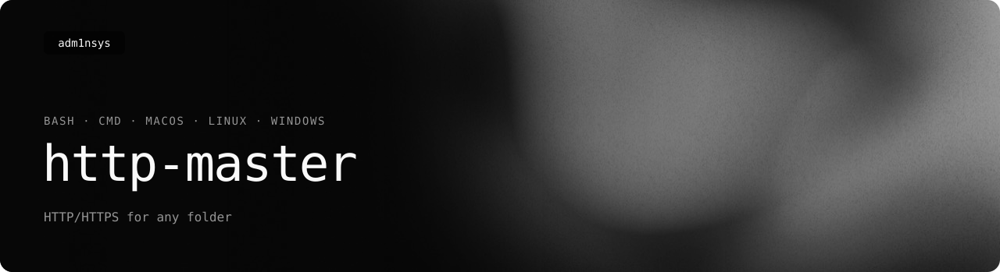

<picture>
  <source media="(prefers-color-scheme: light)" srcset=".github/readme/banner-light.svg">
  
</picture>

<p>
  <a href="https://adm1nsys.github.io/http-master/"></a>
  <a href="https://github.com/adm1nsys/http-master/releases/latest/download/http-master.sh"></a>
  <a href="https://github.com/adm1nsys/http-master/releases/latest/download/http-master.bat"></a>
  <a href="https://adm1nsys.github.io/http-master/#versions"></a>
  <a href="LICENSE"></a>
</p>

Start an HTTP or HTTPS server for any folder from a small terminal menu — on macOS, Linux and Windows.

```
http-master 10.0.0 · static HTTP/HTTPS server for any folder
Need PHP, Node.js apps or a database? → ServerMaster: https://adm1nsys.github.io/ServerMaster/

  Folder           /Users/me/Sites/portfolio
  Port             8080
  Access           this computer only
  HTTPS certificate ready

  [1] Start HTTP           [2] Start HTTPS
  [3] Choose folder        [4] Change port        [5] Toggle access
  [6] Generate certificate [7] Install dependencies
  [8] Check for updates    [9] Open ServerMaster  [0] Quit
```

## Features

- **HTTP and HTTPS** for any folder, served by Node.js [`http-server`](https://github.com/http-party/http-server).
- **Folder picker** — type a path (with tab completion), use the current folder, or pick it in Finder / a dialog / Explorer.
- **Self-signed certificates** generated with openssl, valid for `localhost`, `127.0.0.1` and your LAN address.
- **Local or network access** — keep the server on this computer, or open it to phones and other devices in your Wi-Fi.
- **Free port** — if the port is taken, the next free one is used.
- **Missing dependencies are installed on request**: Node.js and openssl via Homebrew, apt, dnf, pacman, apk or winget; `http-server` via npm or `npx`.
- **Update check** against the latest GitHub release, with self-update.
- **Remembers** the last folder, port and access mode.
- **Scriptable**: every action also works as a flag, e.g. `http-master --serve ./site --https`.

## Install

**macOS / Linux**

```bash
curl -fsSL https://raw.githubusercontent.com/adm1nsys/http-master/main/install.sh | bash
```

This puts `http-master` into `~/.local/bin`. It runs with the system bash (3.2 on macOS is fine) and from zsh.

**Windows 10 / 11**

Download [`http-master.bat`](http-master.bat) and run it, or put it in a folder on your `PATH` to use `http-master` from any terminal.

## Usage

```
http-master                       open the menu
http-master --serve [DIR]         start right away (foreground, Ctrl+C to stop)
    --port N                      port (default 8080 or the last one used)
    --https                       serve over HTTPS (a certificate is generated if needed)
    --network                     listen on all interfaces, not just this computer
http-master --gen-cert            create a new self-signed certificate
http-master --install-deps        install Node.js, http-server and openssl if missing
http-master --check-update        look for a newer release
http-master --version | --help
Add --yes to answer prompts with yes.
```

Settings, certificates and the server log live in `~/.config/http-master` (Windows: `%APPDATA%\http-master`).

## How it is built

| File | Platform |
|---|---|
| [`http-master.sh`](http-master.sh) | macOS and Linux — bash, no dependencies beyond Node.js |
| [`http-master.bat`](http-master.bat) | Windows — cmd, with PowerShell for dialogs and the update check |
| [`install.sh`](install.sh) | one-line installer for macOS and Linux |

Both scripts share the same menu, flags and config. [CI](.github/workflows/ci.yml) runs `shellcheck` and then real smoke tests on Ubuntu, macOS and Windows: start the server over HTTP, generate a certificate, start it over HTTPS and fetch a page each time.

## History

- **2023** — the first version: a bash wizard for macOS around `http-server`, followed by builds for Linux and a native macOS app (the app itself has not survived).
- The idea grew into [ServerMaster](https://adm1nsys.github.io/ServerMaster/) — a full local server manager for static sites, PHP with a database and Node.js apps.
- **2026** — http-master rewritten as the small tool it was meant to be: one menu for HTTP/HTTPS on all three systems, certificates, dependency setup and update checks. The 2023 releases are kept on the [releases page](https://github.com/adm1nsys/http-master/releases).

## License

[MIT](LICENSE) © Heorhii Romanenko
